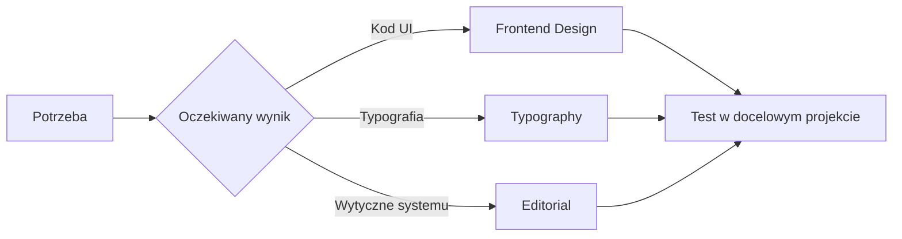

# Przykłady zwartego Markdown na GitHubie

Galeria układów do porównania w widoku renderowanym GitHuba. Dane i statusy poniżej są **przykładowe**, nie opisują wyników kwalifikacji skilli.

[Wpisy zwarte](#1-wpisy-zwarte) · [Tabela](#2-tabela-porównawcza) · [Rozwijanie](#3-rozwijane-szczegóły) · [Alerty](#4-wyróżnienia) · [Schemat](#5-diagram-mermaid) · [Mikrowizualizacje](#6-mikrowizualizacje-tekstowe) · [Checklisty](#7-checklista) · [Hybryda](#8-katalog-hybrydowy)

## 1. Wpisy zwarte

**[Typography](https://github.com/petekp/agent-skills/blob/main/skills/typography/SKILL.md)** — dobór fontów, skala pisma i audyt czytelności.<br>
`UI` · `CSS/Tailwind` · `Referencja`

**[Editorial](https://github.com/bergside/awesome-design-skills/blob/main/skills/editorial/SKILL.md)** — wytyczne systemu projektowego w stylu editorial.<br>
`Tokeny` · `Komponenty` · `Specyfikacja`

**[Frontend Design](https://github.com/thekorn/agent-skills/blob/main/skills/frontend-design/SKILL.md)** — od briefu i kierunku wizualnego do kodu interfejsu.<br>
`Frontend` · `Kod` · `Estetyka`

**Efekt:** krótki opis i etykiety w drugiej linii. Etykiety to zwykły kod inline, nie aktywne filtry.

## 2. Tabela porównawcza

| Potrzeba | Przykładowy skill | Wynik | Granica |
| :--- | :--- | :--- | :--- |
| Czytelny tekst | [Typography](https://github.com/petekp/agent-skills/blob/main/skills/typography/SKILL.md) | Zalecenia + CSS | Nie skład do druku |
| System editorial | [Editorial](https://github.com/bergside/awesome-design-skills/blob/main/skills/editorial/SKILL.md) | Wytyczne komponentów | Nie gotowa publikacja |
| Kod interfejsu | [Frontend Design](https://github.com/thekorn/agent-skills/blob/main/skills/frontend-design/SKILL.md) | Strona lub komponent | Wymaga testów |

**Efekt:** szybkie porównanie. Długie opisy zwiększają wysokość wierszy; na telefonie tabela może wymagać przewijania poziomego.

## 3. Rozwijane szczegóły

<details>
<summary><strong>Typography</strong> — dobór fontów i audyt czytelności</summary>

**Wynik:** zalecenia typograficzne i przykłady CSS/Tailwind.

- **Zakres:** rozmiary, interlinia, długość wiersza, hierarchia.
- **Zastosowanie:** interfejsy cyfrowe i treści do czytania na ekranie.
- **Granica:** nie zastępuje testu czytelności w docelowym interfejsie.

[Otwórz źródło](https://github.com/petekp/agent-skills/blob/main/skills/typography/SKILL.md)

</details>

<details>
<summary><strong>Editorial</strong> — tokeny, komponenty i kryteria dostępności</summary>

**Wynik:** specyfikacja systemu projektowego, nie gotowy skład magazynu.

| Element | Przykład z instrukcji |
| :--- | :--- |
| Typografia | Gelasio |
| Rytm odstępów | Siatka 8pt |
| Kontrola jakości | Kryteria dostępności i checklista QA |

[Otwórz źródło](https://github.com/bergside/awesome-design-skills/blob/main/skills/editorial/SKILL.md)

</details>

<details open>
<summary><strong>Przykład domyślnie otwarty</strong> — można go zwinąć</summary>

Atrybut `open` pokazuje treść od razu. W katalogu zwykle warto pozostawić szczegóły zamknięte, aby skrócić stronę.

</details>

## 4. Wyróżnienia

> [!NOTE]
> Link w katalogu oznacza źródło do przejrzenia, nie zainstalowany ani przetestowany pakiet.

> [!TIP]
> Najpierw wybierz oczekiwany wynik: **kod**, **specyfikacja** albo **audyt**.

> [!IMPORTANT]
> Instrukcja tworzenia dostępnego UI nie jest dowodem, że konkretne UI przeszło testy dostępności.

> [!WARNING]
> Przed kopiowaniem treści sprawdź licencję konkretnego pakietu.

**Efekt:** natywne bloki GitHuba. Warto stosować je oszczędnie — wiele bloków osłabia wyróżnienie.

## 5. Diagram Mermaid



**Efekt:** schemat wyboru renderowany z tekstu. Diagram pokazuje uproszczony przykład wyboru, nie automatyczny mechanizm rekomendacji.

## 6. Mikrowizualizacje tekstowe

### Status + jednoznaczny opis

- 🟢 **Przykład: zweryfikowane** — sprawdzono wskazany warunek.
- 🟡 **Przykład: do sprawdzenia** — brakuje wyniku testu.
- ⚪ **Przykład: tylko link** — nie przeprowadzono kwalifikacji.

Kolor nie jest jedynym nośnikiem informacji: każdy status ma etykietę tekstową.

### Pasek postępu w bloku tekstowym

```text
Przykładowe zakończenie checklisty
Dokumentacja  ████████░░  8/10
Renderowanie  ██████░░░░  6/10
Dostępność    ███░░░░░░░  3/10
```

To dane demonstracyjne. Blok zachowuje odstępy dzięki czcionce monospace; nie jest interaktywnym wykresem.

### Miniaturowy przepływ inline

**Brief → wybór skilla → artefakt → test → decyzja**

`Źródło` → `Przegląd` → `Próba` → `Akceptacja`

**Efekt:** najmniejsza forma schematu, bez obrazów i zewnętrznych bibliotek.

## 7. Checklista

Przykładowy stan prac, wyłącznie do demonstracji:

- [x] Wybrano kategorię.
- [x] Dodano opis oczekiwanego wyniku.
- [ ] Sprawdzono działanie w docelowym projekcie.
- [ ] Oceniono czytelność na telefonie.

**Efekt:** widoczny podział na wykonane i pozostałe działania. W zwykłym pliku README nie traktuj pól jako formularza zapisującego stan.

## 8. Katalog hybrydowy

Krótka tabela służy do wyboru; szczegóły pozostają zwinięte poniżej.

| Wybierz, gdy… | Źródło | Typ wyniku |
| :--- | :--- | :--- |
| Chcesz poprawić tekst | [Typography](https://github.com/petekp/agent-skills/blob/main/skills/typography/SKILL.md) | `Zalecenia + CSS` |
| Chcesz zdefiniować system editorial | [Editorial](https://github.com/bergside/awesome-design-skills/blob/main/skills/editorial/SKILL.md) | `Wytyczne` |
| Chcesz zakodować kierunek wizualny | [Frontend Design](https://github.com/thekorn/agent-skills/blob/main/skills/frontend-design/SKILL.md) | `Kod UI` |

<details>
<summary>Zakres, zależności i ograniczenia</summary>

- **Typography:** szeroki poradnik typografii interfejsów z odsyłaczami do tematów szczegółowych.
- **Editorial:** wytyczne tokenów i komponentów z określonymi podstawami wizualnymi.
- **Frontend Design:** wybór estetyki i implementacja; gotowość wyniku wymaga odrębnego sprawdzenia.

To zestawienie opisuje instrukcje źródłowe, nie porównanie skuteczności modeli.

</details>

---

## Co porównać podczas oglądania

1. **Na komputerze:** czy tabela pomaga wybrać, czy tylko zagęszcza tekst?
2. **Na telefonie:** czy trzeba przewijać poziomo?
3. **Po zwinięciu:** czy same tytuły wystarczają do znalezienia właściwego wpisu?
4. **Bez kolorów:** czy status i zależności pozostają jasne?

Dla krótkiego katalogu: **wpisy zwarte**. Dla porównywania: **tabela**. Dla długich opisów: **układ hybrydowy**. Gdy potrzebne są filtry, wyszukiwarka i własne karty, alternatywą jest osobna strona, np. GitHub Pages.
