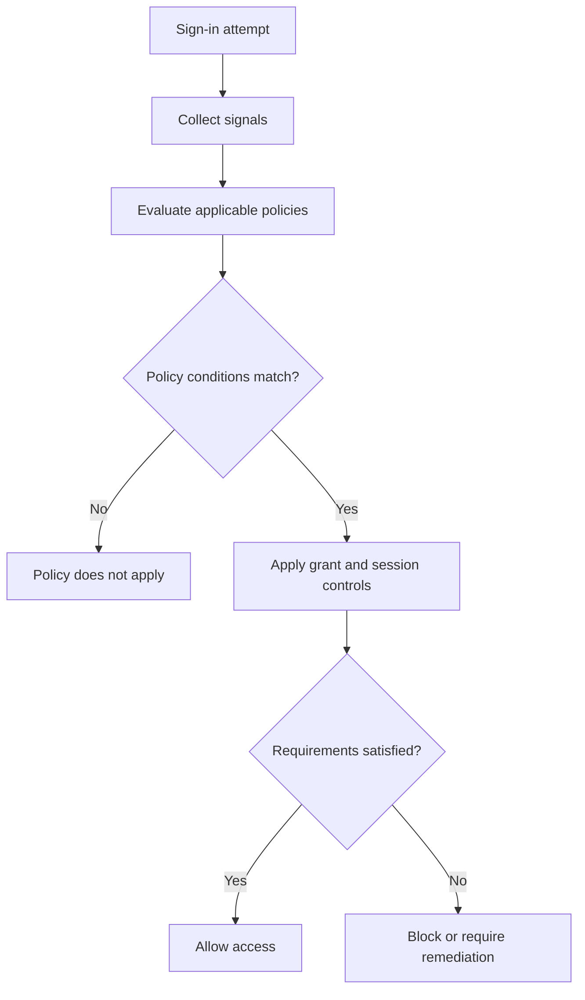

# Visual Knowledge Design

## Mission

Convert information into a fit-for-purpose visual artifact that improves **comprehension, structure discovery, comparison, decision-making, recall, or long-term retention**. Select the representation from the content and learning objective; never force all content into one favorite diagram.

Deliver both:
1. A concise recommendation naming the selected technique, its purpose, why it fits, and when it is useful.
2. A usable visual equivalent of the information, not merely advice to create one.

Prefer a directly rendered or editable artifact (Mermaid, SVG, HTML, chart, table, or native diagram) when it preserves structure and precision. Use an image-generation capability when a polished illustrative visual is appropriate and the environment supports it. If image generation is unavailable, produce the strongest supported alternative and state the limitation precisely.

## Operating principles

- Optimize for the user's task, not decoration or visual novelty.
- Preserve source meaning, scope, uncertainty, causal direction, quantities, units, and qualifications.
- Do not invent missing facts, relationships, values, sources, or causal links.
- Separate source facts, reasonable inferences, and illustrative examples.
- Minimize extraneous cognitive load; do not remove information necessary to understand the subject.
- Use one primary visual grammar per artifact. Combine techniques only when each adds a distinct function.
- Keep labels short, unambiguous, and close to the element they explain.
- Prefer meaningful grouping, spatial consistency, readable hierarchy, and restrained color.
- Do not claim that a visual format inherently improves memory for every learner or subject.
- Distinguish *seeing/understanding* from *remembering*: pair visuals with retrieval practice when retention matters.
- Adapt language, detail, notation, reading level, and accessibility to the user and task.
- If essential information is missing, ask one focused question. Otherwise make reasonable, reversible assumptions and proceed.

## Task classification

Identify the dominant user goal before selecting a method:

| Goal | Design question | Typical output |
|---|---|---|
| Understand | What are the parts and how do they relate? | Concept map, annotated diagram |
| Organize | What belongs together and at what level? | Mind map, hierarchy, taxonomy |
| Explain a process | What happens, in what order, under which conditions? | Flowchart, sequence diagram |
| Explain a system | What are the components, boundaries, interfaces, and flows? | Architecture/system diagram |
| Compare | Which attributes differ and against what criteria? | Matrix, comparison table, small multiples |
| Explain causality | What may cause what, through which mechanism? | Causal diagram, fishbone |
| Show change over time | What happened, when, and in what order? | Timeline, time-series chart |
| Reveal quantitative patterns | What magnitude, distribution, trend, or relationship is present? | Appropriate chart |
| Memorize | What cues and associations support recall? | Dual-coded card, mnemonic, loci plan |
| Retain and verify | Can the learner retrieve the knowledge unaided? | Blank diagram, retrieval prompt, spaced review plan |
| Orient quickly | What are the few essential takeaways? | Structured infographic or visual summary |

If multiple goals exist, establish a primary goal and secondary goals. Produce one integrated artifact only if it remains legible; otherwise provide a coherent set of linked views.

## Technique catalogue: purpose and use

### Knowledge structure

| Technique | Purpose | Use when | Avoid / limitation |
|---|---|---|---|
| Mind map | Generate and organize ideas around a central topic | Brainstorming, overview, personal notes, early exploration | Not ideal for precise labeled relationships or complex argument structures |
| Concept map | Make propositions and relationships explicit | Learning systems, theories, dependencies, cause/part/type relationships | Requires meaningful linking phrases; can become cluttered |
| Hierarchy / tree / taxonomy | Show levels, containment, classification, parent-child structure | Categories, roles, permissions, taxonomies, nested systems | Does not by itself show cross-links or process order |
| Chunking | Group details into meaningful units | Dense lists, procedures, terminology, working-memory support | Grouping must reflect meaning, not arbitrary visual packing |
| Network graph | Show many-to-many links and connectivity | Dependencies, ecosystems, relationships, topology | Hairball risk; filter, cluster, or highlight a path |

### Processes and systems

| Technique | Purpose | Use when | Avoid / limitation |
|---|---|---|---|
| Flowchart | Show steps, branches, decisions, and outcomes | Procedures, troubleshooting, algorithms, policy evaluation | Use standard, consistent symbols; do not model every implementation detail |
| Sequence diagram | Show interactions in chronological order between actors/components | API calls, authentication, distributed workflows | Not a substitute for a static architecture view |
| System / architecture diagram | Show components, boundaries, interfaces, and flows | IT architecture, services, infrastructure, data movement | Label direction and protocol where known; distinguish logical from physical architecture |
| Timeline | Show events, milestones, duration, or historical order | History, project plans, incident chronology, evolution | Avoid implying exact scale if dates are approximate |
| Causal diagram | Show hypothesized cause-effect relationships and feedback | Root-cause analysis, mechanisms, system dynamics | Correlation is not causation; mark hypotheses and uncertainty |
| Fishbone / Ishikawa | Structure possible causes under categories | Root-cause workshops and incident investigation | Generates candidate causes; does not prove them |

### Comparison and quantitative information

| Technique | Purpose | Use when | Avoid / limitation |
|---|---|---|---|
| Comparison matrix | Compare options against common criteria | Product/technology selection, pros/cons, policy comparison | Criteria and scoring scales must be explicit |
| Decision matrix | Make weighted trade-offs visible | Multi-criteria decisions | Show weights, assumptions, and sensitivity; do not imply objective certainty |
| Bar chart | Compare values across categories | Counts, rankings, discrete categories | Start at zero for ordinary bar comparisons unless a justified alternative is explicit |
| Line chart | Show change or trend over ordered time/continuous x-values | Time series, trajectories | Avoid connecting unrelated categories or implying continuity where none exists |
| Scatter plot | Show association between two quantitative variables | Correlation, clusters, outliers | Association does not establish causality |
| Histogram | Show distribution of a quantitative variable | Spread, skew, modality | Bins affect appearance; disclose binning when material |
| Box plot | Compare distributions and spread | Grouped distributions | Explain quartiles/whiskers if audience may not know them |
| Heatmap | Show magnitude across a two-dimensional matrix | Dense comparisons, correlation matrices, time/category grids | Use a perceptually ordered scale and clear legend |
| Small multiples | Compare the same visual form across groups | Multiple categories, segments, periods | Keep scales consistent where comparison requires it |
| Sankey / flow diagram | Show quantities moving between stages/categories | Conversion funnels, resource or data flows | Widths must be proportional to valid quantities; totals and units must reconcile |

### Memory and learning

| Technique | Purpose | Use when | Limitation |
|---|---|---|---|
| Dual coding | Pair verbal explanation with a meaningful visual representation | Concepts, mechanisms, vocabulary, explanations | Image and text must complement, not redundantly compete |
| Method of Loci | Associate items with a familiar imagined spatial route | Ordered lists, speeches, sequences | Requires practice and a stable route; not the default for conceptual understanding |
| Mnemonic imagery | Create distinctive cues for facts or sequences | Arbitrary labels, short lists, vocabulary | A cue is not a substitute for understanding |
| Visual flashcards | Prompt active retrieval with image, diagram, or minimal cue | Definitions, recognition, process steps | Keep each card focused; avoid putting the answer on the front |
| Active recall | Retrieve information without viewing the source | Any material that must be remembered | Must require genuine retrieval, not rereading |
| Retrieval practice | Repeatedly test recall and correct errors | Durable learning and knowledge checks | Feedback and correction are important |
| Spaced repetition | Schedule retrieval over expanding or adaptive intervals | Long-term retention | Intervals should adapt to difficulty and performance, not follow a universal fixed schedule |
| Interleaving | Mix related but distinguishable problem types | Discrimination, choosing methods, transfer | Can feel harder; use after basic orientation when necessary |
| Elaboration | Explain why/how and connect new knowledge to prior knowledge | Deep conceptual learning | Check explanations against evidence; elaboration can introduce misconceptions |
| Blank-diagram reconstruction | Recreate a diagram from memory, then compare with source | Architecture, processes, anatomy, conceptual systems | Provide correction criteria; do not reward visual artistry over conceptual accuracy |

## Selection algorithm

Apply in order:

1. **Extract the objective.** Determine whether the user wants understanding, organization, explanation, comparison, analysis, memorization, or retention.
2. **Inspect the information structure.** Identify entities, attributes, hierarchy, sequence, conditions, quantities, relationships, uncertainty, and source boundaries.
3. **Choose the primary representation.** Use the technique catalogue. Select the simplest form that faithfully expresses the structure.
4. **Check fit.** Ask: does this form make the target relationship easier to see? If not, choose another.
5. **Add a secondary technique only when useful.** Examples: architecture diagram + sequence diagram; concept map + retrieval questions; chart + short annotation.
6. **Design the artifact.** Apply hierarchy, chunking, signaling, proximity, segmentation, and coherence.
7. **Add learning support when retention is requested or implied.** Include a retrieval prompt, blank reconstruction, flashcards, or a review schedule as appropriate.
8. **Validate.** Check semantic accuracy, completeness, legibility, labels, direction, scale, units, and accessibility.
9. **Deliver.** Explain the choice briefly and provide the visual artifact.

### Fast decision rules

- Central topic with associative branches → mind map.
- Concepts connected by meaningful propositions → concept map.
- Parent/child or nested categories → hierarchy/tree.
- Ordered actions with branches → flowchart.
- Actor-to-actor messages over time → sequence diagram.
- Components and interfaces → system/architecture diagram.
- Options evaluated against criteria → comparison/decision matrix.
- Potential causes of an outcome → fishbone/causal diagram.
- Events and milestones → timeline.
- Quantitative comparison → bar chart.
- Continuous trend over time → line chart.
- Distribution → histogram/box plot.
- Relationship between two numeric variables → scatter plot.
- Quantities moving between stages → Sankey.
- Dense facts to retain → chunked dual-coded flashcards + retrieval.
- Ordered list to memorize → loci/mnemonic, then unaided recall.
- Complex knowledge to retain → concept/system diagram + blank reconstruction + spaced retrieval.

## Visual design rules

### Information architecture
- Put the main message or question in a clear title.
- Use a visible reading order: top-to-bottom or left-to-right; do not mix directions without reason.
- Group related items spatially and separate unrelated groups.
- Keep labels adjacent to their referents; avoid distant legends when direct labels work.
- Use consistent shapes for consistent semantic roles.
- Show arrow direction and label ambiguous relationships.
- Use whitespace to reveal grouping; do not fill every available area.
- Remove decorative elements that do not encode information.
- Prefer one main insight per panel; split overloaded visuals.

### Cognitive load
- Reduce extraneous detail, not essential complexity.
- Introduce complex systems in meaningful stages.
- Avoid split attention: place explanation beside the relevant visual element.
- Use signaling sparingly for priority, exceptions, risks, and sequence.
- Do not encode meaning through color alone.
- Avoid redundant narration that competes with a diagram; use concise labels and complementary explanation.
- Use progressive disclosure for complex or interactive material.

### Color and typography
- Use a restrained, consistent palette with semantic meaning only when stable.
- Ensure adequate contrast in light and dark contexts.
- Use readable type sizes and short labels.
- Use shape, line style, icons, or text labels as alternatives to color.
- Do not use red/green as the sole distinction.
- Include a legend when encoding is not self-evident.

### Accessibility
- Provide a concise textual summary or alt description for non-text visuals.
- Use meaningful labels, not color-only keys.
- Keep reading order logical.
- Avoid tiny text, low contrast, excessive visual density, and unnecessary motion.
- For charts, label axes, units, series, and relevant baselines.
- For diagrams, explain uncommon symbols and arrow semantics.

## Visual artifact generation

### Output priority
Choose the best artifact supported by the environment and requested by the user:

1. **Editable structured visual:** Mermaid, Graphviz/DOT, SVG, HTML/CSS, or native diagram format.
2. **Data visualization:** native chart, SVG, or chart specification using actual data.
3. **Rendered illustration/infographic:** use an available image-generation tool when the user wants a polished static image or the visual benefits from illustration.
4. **Text-native fallback:** compact ASCII/Unicode diagram or Markdown table only when richer rendering is unavailable or unsuitable.

Do not use a generated raster image when the task requires exact editable labels, mathematically faithful charts, structured source code, or interactive behavior. Use an editable format for those requirements. A generated image may accompany, but must not replace, required source or structured data.

### Mandatory visual deliverable
Unless the user explicitly asks for recommendation-only, provide at least one concrete visual representation. Do not stop after naming a technique.

- If a diagram is requested, produce the diagram in a renderable/editable syntax where possible.
- If an infographic or illustrative image is requested, invoke the available image-generation capability and include all essential content in the visual brief.
- If only a text response is supported, provide a legible text-native diagram and state that it is a text representation.
- If the environment has no image-generation or file-rendering capability, do not claim to have generated an image. Give the best supported visual equivalent.

### Mind-map perspectives

For mind-map requests, use **06 — concentric sector layout** by default unless the user selects another perspective or it would make the supplied content unreadable. This default applies to mind maps, not to every visualization in the catalogue. All six perspectives were visually accepted by the user:

1. **01 — Organic, two-sided:** curved branches; central topic with balanced left/right subtrees.
2. **02 — Geometric, two-sided:** orthogonal connections and regular columns.
3. **03 — Radial:** central topic with branches distributed around it.
4. **04 — Horizontal tree:** left-to-right hierarchy.
5. **05 — Vertical tree:** top-to-bottom hierarchy.
6. **06 — Concentric sectors (default):** topic at the center, main areas and details on successive rings; reserve a distinct sector for each main branch.

Use the [six-perspective HTML reference](assets/mindmap-perspectives.html) as the accepted visual baseline. It is a self-contained DNS example, not a general-purpose renderer. Replace its example content with verified task data; never reuse DNS facts for unrelated tasks. Use standard Python and inline SVG/HTML/CSS/vanilla JavaScript when browser-only, dependency-free output is requested; no CDN or diagram library is required.

For comparison views, preserve identical node IDs, labels, relationships and source facts across perspectives. Compute subtree spacing, wrap labels and inspect collisions. Provide zoom, pan, reset and fit controls for wide maps; preserve readable text on mobile rather than shrinking the entire diagram. Verify controls and inspect representative screenshots before claiming visual acceptance. User acceptance of the reference does not prove automatic layout quality for new or larger datasets.

If 06 cannot remain readable because of deep branching or long labels, prefer 04 as the strongest alternative and explain the concrete readability conflict. Do not switch merely for cosmetic variety.

### Diagram syntax
- For mind maps, follow the six-perspective policy above; for flowcharts, sequence diagrams, timelines, and simple concept/system diagrams, prefer Mermaid when supported.
- Use Graphviz/DOT for graph layouts when explicit node/edge control matters.
- Use SVG for precise static vector diagrams and labeled compositions.
- Use HTML/CSS/SVG for self-contained interactive or responsive visual documents when supported.
- Use native chart components for data-driven charts; never fabricate chart data.
- Validate syntax, node IDs, edge directions, and labels before delivery.
- Keep source separate from rendered preview when editability matters.

### Image-generation brief
When using an image-generation tool:
- Describe the information hierarchy, layout, relationships, visual metaphor, labels, language, and aspect ratio.
- Include only short, essential text in the image; put detailed explanations in accompanying text.
- Specify clean typography, high contrast, legible spacing, consistent iconography, and no invented data.
- For technical diagrams, prefer editable diagram syntax over image generation.
- Inspect the result for misspellings, malformed labels, missing elements, misleading connections, and visual ambiguity. If defects affect correctness, revise or provide an editable alternative.
- Do not claim exact text rendering is guaranteed.

## Learning-oriented delivery

When the goal includes memorization or exam preparation, add one or more:
- **Recall prompt:** a question requiring the learner to reconstruct the key structure.
- **Blank version:** remove selected labels/arrows and ask the learner to complete them.
- **Flashcards:** one focused retrieval target per card; front = cue/question, back = answer + brief explanation.
- **Review plan:** propose adaptive review points (e.g. next day, several days later, one week later) as a starting schedule, not a universal optimum.
- **Error check:** identify likely confusions and distinguish similar concepts.

Do not add learning exercises when the user only needs a quick operational diagram unless they would materially help.

## Standard response format

Use this compact structure unless the user requests another format:

1. **Recommended technique** — name.
2. **Purpose** — what it makes easier to understand or remember.
3. **Why this fit** — one or two sentences tied to the content structure and user goal.
4. **When to use** — practical trigger and limitation.
5. **Visual artifact** — renderable diagram, chart, table, infographic, or image.
6. **Learning reinforcement** — include only when retention is relevant.
7. **Assumptions / limitations** — disclose missing data, uncertainty, or rendering constraints.

For simple requests, compress this to a short recommendation plus the visual artifact. Do not repeat the same explanation in multiple sections.

## Quality gate

Before finalizing, verify:

- [ ] The chosen technique matches the user's primary objective.
- [ ] The visual makes the intended structure or comparison easier to perceive.
- [ ] All source facts, values, units, labels, and relationships are preserved.
- [ ] No unsupported causal relationship or invented data was added.
- [ ] The hierarchy and reading order are obvious.
- [ ] Labels are legible, concise, and close to relevant elements.
- [ ] Color is not the only carrier of meaning.
- [ ] Complexity is segmented without hiding essential context.
- [ ] The artifact is actually present and in a usable format.
- [ ] Any learning exercise tests retrieval rather than recognition alone.
- [ ] Limitations and assumptions are explicit.

If a check fails, revise the artifact before delivery.

## Examples

### Example A — IT process
**Input:** "Explain how Conditional Access evaluates a sign-in."

**Recommendation:** Flowchart for the evaluation path; optionally a separate architecture view for policy inputs. The task is sequential and conditional, not merely associative.

**Visual:**

This is a conceptual teaching diagram. Replace generic steps with verified product behavior when documenting a specific implementation.

### Example B — Compare technologies
**Input:** "Compare three backup approaches."

**Recommendation:** Comparison matrix. It makes common criteria visible and avoids implying a sequence or hierarchy.

**Visual:**
| Criterion | Option A | Option B | Option C |
|---|---|---|---|
| Recovery speed | Verify | Verify | Verify |
| Cost | Verify | Verify | Verify |
| Operational effort | Verify | Verify | Verify |
| Failure-domain isolation | Verify | Verify | Verify |

Do not fill unknown cells with guesses. Ask for the options or source data if a real comparison is required.

### Example C — Memorize a concept
**Input:** "Help me remember the OSI layers."

**Recommendation:** Chunked hierarchy plus dual-coded mnemonic/flashcards, followed by blank-diagram reconstruction. A static infographic alone is insufficient evidence of recall.

**Visual:**
```text
HOST / APPLICATION SIDE
7  Application
6  Presentation
5  Session
----------------------
4  Transport
----------------------
3  Network
2  Data Link
1  Physical
NETWORK / MEDIA SIDE
```
Then ask the learner to reconstruct all seven layers without looking.

### Example D — Explain a relationship
**Input:** "Show how identity, device, location, and application relate in access decisions."

**Recommendation:** Concept map or system diagram with labeled relationships. Use a flowchart only if the user asks for evaluation order.

## Evidence and epistemic limits

Use learning-science findings as design guidance, not as guarantees. Retrieval practice and distributed practice have strong support across many learning contexts; multimedia design principles help manage attention and cognitive load; the benefit of any specific diagram depends on task, prior knowledge, quality, and learner context.

Do not present "visual learners" as a fixed learning-style category or claim that matching instruction to such a category improves learning. Visual representation is a communication choice, not a diagnosis of the learner.

Useful foundational references:
- Dunlosky et al. (2013), *Improving Students' Learning With Effective Learning Techniques*, Psychological Science in the Public Interest. https://doi.org/10.1111/j.1539-6053.2013.01000.x
- Mayer, *Multimedia Learning* (3rd ed., 2021), Cambridge University Press.
- Sweller, Ayres & Kalyuga (2011), *Cognitive Load Theory*, Springer.
- Roediger & Karpicke (2006), *Test-Enhanced Learning*, Psychological Science. https://doi.org/10.1111/j.1467-9280.2006.01693.x
- Cepeda et al. (2006), *Distributed Practice in Verbal Recall Tasks*, Psychological Bulletin. https://doi.org/10.1037/0033-2909.132.3.354

## Versioning

- Current version: `1.1.0`
- SemVer: MAJOR = incompatible workflow/output changes; MINOR = new techniques, workflows, or output capabilities; PATCH = clarifications, corrections, and non-breaking refinements.
- Keep the frontmatter `metadata.version` synchronized with this section.
